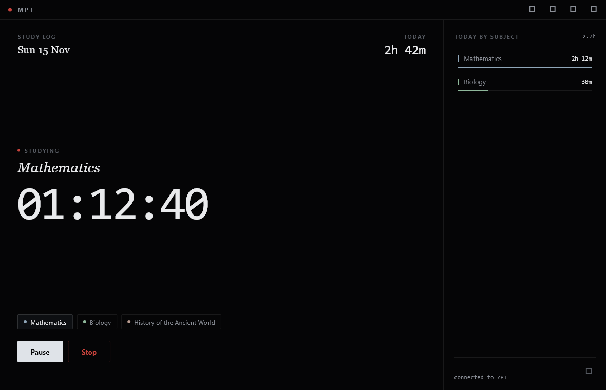

# Mpt

Minimal desktop study timer for **[Yeolpumta / YPT](https://yeolpumta.com)**, built from the open-source [Desky](https://github.com/huneyoliv/desky) client. It signs into your existing YPT account, so sessions you run on the PC land on the same account as your phone.

Dark, hairline-ruled, one red accent — the look of `indexstudy.html`.

| Screen | Preview |
| --- | --- |
| Login |  |
| Studying |  |
| Mini player |  |

## What it does

Four things, on purpose:

1. **Timer** — start / pause (rest) / stop, written to YPT with `POST /study/start`, `POST /study/stop` and `POST /study/study-plan/rest`. A session snapshots itself to disk, so a crash or a restart restores it instead of losing the time.
2. **Subjects** — the same subject list as the account, with colours. Pick one with a click before starting.
3. **Today by subject** — the right-hand panel is always visible: every subject studied today with its hours, a hairline bar sized against your biggest subject, and the live remainder of a running session folded in. No menus, no drilling in.
4. **Offline queue** — a stop that cannot reach YPT is queued in `SharedPreferences` and replayed later, with a duplicate guard.

Plus a **mini player**: the same window, shrunk to 360×148 and pinned on top, with subject, clock and the two actions that matter.

## What was removed from Desky

Groups and chat, rankings and heatmaps, planner/timetable/D-Days, flashcards, store, notifications, PDF reader (SmartBook), challenges, Discord RPC, auto-update, pomodoro mode, daily-goal ring, language switcher, multi-platform shells.

Everything that remains is the code path that actually talks to YPT: `core/api`, `core/oauth`, `core/constants`, `data/repositories` (auth, subject, timer, offline), the user/subject models, and the translation table the repositories use for error messages.

## How the numbers stay honest

`/logs/day` returns both per-subject totals (`dl.ss`) and the raw session list (`dl.ls`). Desky summed both, which double counts every subject. Mpt parses the payload once, in `lib/data/daily_stats.dart`:

- `dl.ss` wins when present; `dl.ls` is only a fallback.
- The running session is added as a *delta* (`sessionElapsedMs - lastSyncedMs`), so a pause that already reached the server is never counted again.
- The panel therefore matches the phone, plus the seconds not yet sent.

## Bugs fixed from the original

| Bug in Desky | Fix in Mpt |
| --- | --- |
| Reconciliation keyed on `dl.is`, which the API never returns — phone→PC sync silently never ran | Read-only probe of an open session (`remoteActive` badge); totals poll `/logs/day` every 30 s |
| `_stopFromServer` could wipe a running local session on a partial/zeroed response | The local timer is authoritative; the client never stops itself because of a poll |
| Pause restored as *running* after a restart (snapshot had no paused flag or accumulated time) | Snapshot stores `is_resting`, `accumulated_ms`, rest start and rest ms |
| Resume posted the whole session again, duplicating the first segment on YPT | Each segment is posted with its own start instant and its own duration (`segmentBaseMs`) |
| Offline replay could record a stop that had already succeeded | `hasRecordedSession()` checks `dl.ls` before replaying |
| Day rollover could zero `todayTotalMs` mid-session and then double count from the server | Rollover clears the day's stats and refetches server truth; the live delta is separate |
| Percent-per-subject parsing summed `ss` and `ls` | `DailyStats` reads one source |
| Closing the window left a session open on the account forever | `onWindowClose` stops and syncs (or queues) before the window is destroyed |
| Mini player size clamped by the main window's 900 px minimum | Minimum size is lowered before shrinking, restored on exit |
| Logout kept the previous account's subjects and totals in memory | `timerProvider` is invalidated on sign-out |

## Running it

Flutter 3.47.7 / Dart 3.13.5. **Windows builds need Visual Studio with the "Desktop development with C++" workload** — this machine did not have it, so the source is verified by analysis and tests rather than by a compiled `.exe`.

```powershell
# this network blocks pub.dev (403), so the mirror is required
$env:PUB_HOSTED_URL="https://pub.flutter-io.cn"
$env:FLUTTER_STORAGE_BASE_URL="https://storage.flutter-io.cn"

flutter pub get
flutter analyze
flutter test                 # 21 tests, all offline
flutter run -d windows
flutter build windows --release
```

Both variables are already set at user level on this machine, so a normal terminal honours them.

A `.env` is optional and only needed for Google sign-in:

```powershell
copy .env.example .env    # fill GOOGLE_CLIENT_ID / GOOGLE_CLIENT_SECRET
```

Without it the Google button is hidden; e-mail and password always works.

## Tests

`flutter test` covers what can be tested without an account:

- `test/daily_stats_test.dart` — totals, fallback parsing, live delta, no double count.
- `test/timer_notifier_test.dart` — segment maths across pause/resume, rejected starts, offline stops, restart restore.
- `test/offline_sync_test.dart` — queue replay, duplicate suppression, retries.
- `test/app_smoke_test.dart` — login, full study screen at 900×560, mini player at 360×148, no overflow.

Visual snapshots can be regenerated with:

```powershell
flutter test tool/preview_test.dart --update-goldens
```

They are rendered with the system Segoe UI / Georgia / Consolas faces, which is also what the app uses — no font downloads, instant first frame.

## Known limits

- YPT's API is private and undocumented; `docs` from Desky describe it, but a server change breaks clients.
- Phone→PC session *mirroring* is intentionally read-only: adopting a remote session and then stopping it would make YPT count the same minutes twice. You get a `PHONE LIVE` badge and live totals instead.
- No auto-update, no tray icon, no second-instance forwarding.

Unofficial client, not affiliated with Yeolpumta.
