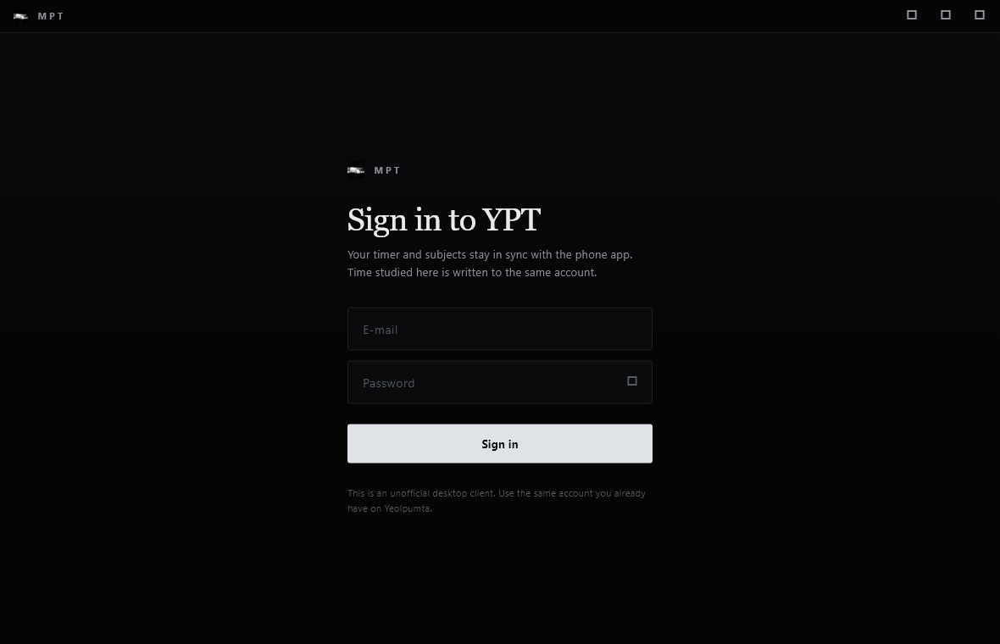
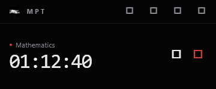

# Mpt

Minimal desktop study timer for **[Yeolpumta / YPT](https://yeolpumta.com)**, written in Rust. It signs into your existing YPT account, so sessions you run on the PC land on the same account as your phone.

Dark, hairline-ruled, one red accent.

| Screen | Preview |
| --- | --- |
| Login |  |
| Studying |  |
| Mini player |  |

## What it does

Four things, on purpose:

1. **Timer** — start / pause (rest) / stop, written to YPT with `POST /study/start`, `POST /study/stop` and `POST /study/study-plan/rest`. A session snapshots itself to disk, so a crash or a restart restores it instead of losing the time.
2. **Subjects** — the same subject list as the account, with colours. Pick one with a click before starting; the strip shows as many chips as fit and the `›` control lists all of them, with today's time beside each. While a session is running the list is locked, so a stray click cannot move minutes to the wrong subject.
3. **Today by subject** — the right-hand panel is always visible: every subject studied today with its hours, a thin bar sized against your biggest subject, and the live remainder of a running session folded in. Sessions logged on the phone count too, not just the ones started here.
4. **Offline queue** — a stop that cannot reach YPT is saved locally and replayed later — on the next sign-in, or with the *sync now* link in the panel. A duplicate guard asks the server whether that session is already there before posting, so a lost response does not become a double entry.

Plus a **mini player**: the same window, shrunk to 360×148 and pinned on top, with subject, clock and the two actions that matter.

## How the numbers stay honest

`/logs/day` returns both per-subject totals (`ss`) and the raw session list (`ls`). Summing both double counts every subject. Mpt parses the payload once, in `src/daily_stats.rs`:

- Each list is summed on its own, then the larger total wins per subject — so a session YPT stored in only one of them still shows, and one stored in both is still counted once.
- A dated request that comes back empty is retried without `date`, because YPT buckets the day in the account's timezone, which may not be the machine's.
- The panel refreshes every 30 s, on window focus, and after every stop.
- The running session is added as a *delta* (`elapsed − last synced`), so a pause that already reached the server is never counted again.
- The panel therefore matches the phone, plus the seconds not yet sent.

## Install

Grab `Mpt-windows-x64.zip` from the [releases page](https://github.com/moonkip18/Mpt/releases), unzip it anywhere, run `mpt.exe`. Settings and the session snapshot live in `%APPDATA%\Mpt`; delete that folder to reset the app. If it ever closes on its own, `%APPDATA%\Mpt\crash.log` holds the reason.

## Build

Rust 1.85 or newer (the crate uses edition 2024).

```sh
cargo build --release
```

The exe lands at `target/release/mpt.exe`. On Windows the MSVC toolchain is the path of least resistance; `cargo check` is enough if you only want to confirm the code compiles. The icon and version stamp in `assets/app.rc` are compiled only by MSVC (it owns `rc.exe`), so a GNU build simply produces a plain exe.

CI builds every push and attaches the zip to tagged releases, so you do not need a local toolchain to get a binary — see `.github/workflows/build.yml`. Every run keeps the zip under *Actions → build → Artifacts*; tagged pushes also create a release with the zip attached.

A `.env` is optional and only needed for Google sign-in:

```powershell
copy .env.example .env    # fill GOOGLE_CLIENT_ID / GOOGLE_CLIENT_SECRET
```

Without it the Google button is hidden; e-mail and password always works.

## Where things live

| File | Job |
| --- | --- |
| `src/main.rs` | window, frame loop, resize edges, closing the app cleanly |
| `src/ui/` | login screen, study screen, mini player |
| `src/timer.rs` | the session state machine, on its own thread |
| `src/repositories/` | the YPT calls: auth, subjects, timer, offline queue |
| `src/daily_stats.rs` | turning `/logs/day` into per-subject totals |
| `src/state.rs` | one shared snapshot the UI and the workers both read |
| `src/background.rs` | the quiet drifting backdrop |
| `src/store.rs` | `%APPDATA%\Mpt` — prefs, session snapshot, crash log |

Network work never runs on the UI thread: auth, the timer, and the offline queue each own a worker that reports back through the shared snapshot.

## Known limits

- YPT's API is private and undocumented, so a server change can break the client.
- Phone → PC session mirroring is read-only on purpose. Adopting a session that started on the phone and then stopping it would make YPT count those minutes twice, so you get a `PHONE LIVE` badge and live totals instead.
- No auto-update, no tray icon, no second-instance forwarding.

Unofficial client. Not affiliated with Yeolpumta.
